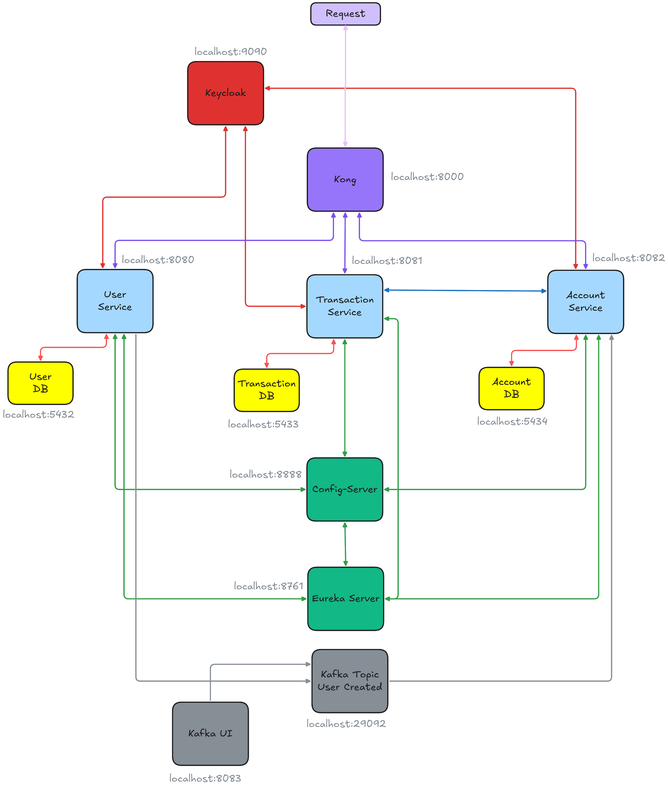

## Bank System
[](https://github.com/EnriqueBravo115/bank/actions/workflows/ci.yml)
[](https://github.com/EnriqueBravo115/bank/actions/workflows/e2e.yml)

A microservices-based banking system built with Spring Boot and modern cloud-native technologies.
The project simulates core banking operations such as account management, transactions, and user onboarding.

It integrates authentication, API gateway, service discovery, and resilience patterns.



## Architecture
- **Kong** is the single entry point (`/api/v1/user`, `/api/v1/account`, `/api/v1/transaction`);
  every request carries a Keycloak JWT.
- **user-service**, **account-service** and **transaction-service** each own a PostgreSQL database.
- **Eureka** for service discovery and **Config Server** for the configuration (`config-server/.../config/`).
- **Kafka** carries the user events (user-service → account-service); **OpenFeign** carries the money
  movements (transaction-service → account-service, with a service token and a circuit breaker).
- **Prometheus + Grafana** for metrics; **Mailpit** receives Keycloak's emails.

## Tech Stack
- **Language and build**: Java 17, Maven.
- **Framework**: Spring Boot 3.5.16, Spring Web, Spring Validation, Spring Boot Actuator, Spring DevTools, Lombok, ModelMapper.
- **Microservices**: Spring Cloud, Eureka Server, Spring Cloud Config Server, OpenFeign, Resilience4j.
- **Persistence**: PostgreSQL 15, Spring Data JPA, Flyway.
- **Messaging**: Apache Kafka 4.2, Spring Kafka, Kafka UI.
- **Security**: Spring Security, OAuth2, JWT, Keycloak 26, Keycloak Admin Client.
- **API Gateway**: Kong 3.6, decK.
- **Email**: Mailpit.
- **Monitoring**: Micrometer, Prometheus 3, Grafana 11.
- **Testing**: JUnit 5, Spring Boot Test, Spring Security Test, Spring Kafka Test, Testcontainers.
- **Infrastructure and deployment**: Docker, Docker Compose, Kubernetes, Kustomize, kind.

## Features
### User Service
`user-service` owns the customer: onboarding, identity data (profile, KYC, financial info) and the
user's lifecycle. It keeps its own Postgres database in sync with Keycloak, which handles login,
roles and email verification, and tells `account-service` about changes through Kafka.

#### Registration Architecture
Registration starts in `user-service`, which keeps its own Postgres database and Keycloak in sync
and, once the KYC step succeeds, asks `account-service` (through Kafka) to open the user's account.

1. `POST /user/register` (public): creates the user in Keycloak and Postgres
   with status `REGISTER` and sends the verification email. Duplicate email or phone → `409`.
2. `PUT /user/register/me/profile`: requires status `REGISTER`; saves names, gender and
   birthday (adults only), updates the user's names in Keycloak and moves to `PROFILE`.
3. `PUT /user/register/me/kyc`: requires status `PROFILE` and a verified email; validates
   CURP and RFC (format, match with each other and with the birthday, not already registered),
   assigns the `CUSTOMER_BASIC` role in Keycloak, moves to `KYC` and enqueues the
   `user-service.account-requested` Kafka event.
4. `PUT /user/register/me/financial`: requires status `KYC`; moves to `COMPLETE`.

After step 1 the user logs in, and the remaining steps act on the JWT owner (`/me`).
During registration the user can also resend the verification email
(`POST /user/register/me/verify-email`) and fix a mistyped email (`PUT /user/me/email`, the same
endpoint customers use later). Emails are stored in lowercase. At KYC the customer may choose the
account type and currency (`SAVING` in `MX` by default); the second surname is optional.

#### Account Management
- **Contact changes** (customer): `PUT /user/me/email` and `PUT /user/me/phone` (a phone number is
  unique together with its country code). A new email is
  also the Keycloak username, has to be verified again and is propagated to `account-service`.
- **Customer tier** (admin): `PUT /user/{userId}/role` switches between `CUSTOMER_BASIC`,
  `CUSTOMER_PREMIUM` and `CUSTOMER_BUSINESS`. `CUSTOMER_BASIC` is always kept in Keycloak and the
  tier is added on top; `ADMIN` cannot be granted through the API.
- **Block / unblock** (admin): `PUT /user/{userId}/active` disables the Keycloak user, ends its
  sessions and freezes the account in `account-service` (unblocking reopens it).

#### Queries
- **Customer**: `GET .../me` for the user, profile, KYC and financial info, resolved from the JWT,
  so a customer can only read their own data.
- **Admin**: lookups by id, email, RFC or CURP, profile search by name or registration status,
  and the list of active users. Lists are paginated (`page`, `size` up to 100).

#### Access Control
Endpoints are protected with Keycloak JWTs and realm roles (`CUSTOMER_*`, `ADMIN`). On each
request a filter also rejects blocked users (`403`), even if their token has not expired yet,
and, outside the registration steps, users whose registration has not reached `KYC`.
Only user-service checks the database: account-service and transaction-service accept a blocked
user's token until it expires (5 minutes). This is an accepted risk: blocking also freezes the
account, so no money moves, but read-only queries keep working meanwhile.

#### Consistency between Postgres and Keycloak
Each operation runs in a single database transaction. The DB changes are flushed **before** calling
Keycloak, so constraint violations are detected first. If a Keycloak call (or the commit) then
fails, the transaction rolls back and the changes already made in Keycloak are undone
(`RollbackCompensation`), so the step can be retried.

#### Transactional Outbox (user-service → account-service)
Events (`account-requested`, `user-status-changed`, `user-email-changed`) are **not** sent to
Kafka directly from the business logic. They use the *transactional outbox pattern*:

```
PUT /me/kyc ──► [ DB transaction ]
                  ├─ save user_kyc, role = CUSTOMER_BASIC, status = KYC
                  ├─ insert outbox_event (PENDING)        ◄── same transaction
                  └─ Keycloak: assign role + status
                       │ commit (or rollback of everything)
                       ▼
OutboxScheduler (every 2s) ──► EventOutbox.publishPending()
                  ├─ SELECT ... PENDING FOR UPDATE SKIP LOCKED
                  ├─ send to Kafka and wait for the broker ack
                  └─ mark SENT  (on error: retry with backoff, FAILED after 10 attempts)
                       ▼
account-service UserConsumer ──► createAccount (ignored if the user already has one)
```

- A user's events are delivered in order: while one is `FAILED` or waiting to be retried,
  the user's later events wait.
- Admins list `FAILED` events (`GET /user/outbox/failed`) and put them back in the queue
  (`POST /user/outbox/{id}/retry`).
- A daily job deletes `SENT` events older than 7 days.

### Account Service
`account-service` owns accounts, balances, cards and limits.
- **Accounts**: opened from the `account-requested` event (one per user); blocking the user freezes it
  and an email change is applied too. Events that cannot be read go to the `<topic>.DLT` topic.
- **Balances**: every movement writes a new balance row (`OPENING`, `MOVEMENT`); a movement is applied
  or rejected at once. `GET /account/me`, `/me/balance`, and admin lookups by account number, CLABE,
  card number or email.
- **Cards**: `POST /card`, `GET /card/me`, block, unblock and cancel.
- **Limits** per type (`TRANSFER`, `WITHDRAWAL`, `SERVICE`, `PURCHASE`) set by admins.
- **Movements** (`/movement/*`, `SERVICE` role only): transfer, purchase, service payment, withdrawal
  (with fee), deposit and reversal. The `Idempotency-Key` makes a repeated call return the same result.

### Transaction Service
`transaction-service` records the customer's transactions and settles them with `account-service`.

```
POST /transaction/create/transfer ──► save transaction PENDING
                  └─ Feign → account-service /movement (Idempotency-Key = transaction code)
                       ├─ answer   → COMPLETED / DECLINED / FAILED
                       └─ no answer (timeout, down, circuit open) → stays PENDING
Reconciler (every 5s) ──► retries PENDING with backoff (5s … 15 min)
                  └─ after 20 attempts: "stuck" → admin retry or cancel
```

- Types: transfer, purchase, service payment, withdrawal and deposit (admin). Accounts can be given
  by account number, CLABE or card number.
- Lifecycle: cancel (`PENDING` only), reverse (`COMPLETED`, admin), list stuck and retry (admin).
- Queries and analytics: history, filters by date, amount, keyword or identifier, sums, counts and
  averages. A customer only sees transactions of their own accounts.

## Resilience
- Outbox (user-service) and reconciler (transaction-service): no event or movement is lost when Kafka
  or account-service is down; both sides are idempotent.
- Timeouts on every remote call (Kafka, Keycloak, account-service); an unavailable dependency answers
  `503` instead of hanging.
- Kubernetes probes use Spring Boot's liveness/readiness groups, so a database or Keycloak outage does
  not restart the pods. Databases and Kafka keep their data in volumes.

## CI/CD
```
PR / push ──► ci.yml ── per service: mvn verify ─► docker build ─► Trivy (HIGH/CRITICAL gate)
                     └─ manifests: kustomize render, ShellCheck, Trivy config report
push to main / v* tag ──► images pushed to GHCR: sha-<commit>, latest, <version>
CI green on main ──► e2e.yml: kind cluster ─► kubectl apply -k ─► smoke test ─► k8s/tests/e2e.py
nightly / manual ──► e2e.yml + failure tests (k8s/tests/faults.py)
```
- Pull requests only build the services they change; `CI result` is the check to require on `main`.
- Images: `ghcr.io/enriquebravo115/bank-<service>`. Dependabot updates Maven, base images and actions weekly.

## Running
- **docker-compose**: `docker compose up -d --build` (Kong at http://localhost:8000).
- **Kubernetes (kind)**: see [k8s/README.md](k8s/README.md).
- Request examples in `http/`; pending work in [tasks.md](tasks.md).

## Monitoring
Every service exposes Micrometer metrics at `/actuator/prometheus`. Prometheus finds the instances
through Eureka (new replicas are scraped without changing its configuration) and Grafana shows them
in the provisioned **Bank services** dashboard: instances up, requests per second, 4xx/5xx, p95
latency, busiest endpoints, answers of account-service to transaction-service (`PENDING` = no
answer), transactions stuck `PENDING`, Kafka listener calls, heap, CPU, database connections and GC.

| Component  | docker-compose          | kind                    |
|------------|-------------------------|-------------------------|
| Grafana    | http://localhost:3000 (admin / admin) | same          |
| Prometheus | http://localhost:9091   | same                    |

`/actuator/prometheus` requires the `METRICS` (or `ADMIN`) realm role: Prometheus requests a
client-credentials token from Keycloak with the `prometheus` client. The configuration lives in
`k8s/monitoring/` and docker-compose mounts it from there.
